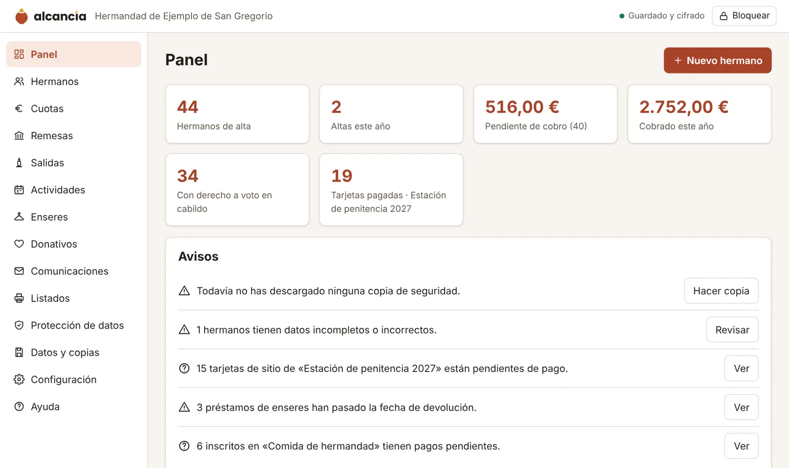

  <picture>
    <source media="(prefers-color-scheme: dark)" srcset="marca/alcancia_logo_blanco.svg">
    
  </picture>

  <strong>Gestión gratuita de socios, cuotas y remesas para hermandades, AMPAs, clubes y asociaciones. 
  Sin servidores, sin registro y con los datos cifrados en vuestro propio ordenador.</strong>

  <a href="https://alcancia.work">Web</a> ·
  <a href="https://alcancia.work/demo/">Probar la demo</a> ·
  <a href="https://alcancia.work/app/">Abrir Alcancía</a> ·
  <a href="https://github.com/luisserranopro/Alcancia/releases/latest/download/alcancia.html">Descargar</a> ·
  <a href="https://alcancia.work/guia.html">Guía</a>

---

## Qué es

**Alcancía** es un programa gratuito para las juntas que llevan las cuentas de su entidad en su tiempo libre: secretarías y tesorerías de hermandades y cofradías, AMPAs, clubes deportivos y asociaciones de hasta unos 10.000 miembros que hoy trabajan con hojas de cálculo.

Funciona en el navegador (Chrome o Edge), también sin conexión, y no tiene servidor: los datos se guardan **cifrados con vuestra contraseña** en el ordenador de la entidad y, si queréis, en un fichero de vuestra propia nube. Nadie más puede verlos, tampoco quien desarrolla el programa.

## Qué hace

| | |
|---|---|
| **Censo** | Altas, bajas y fichas completas, con avisos de DNI o IBAN erróneos y de menores sin persona tutora. Escudo o logotipo de la entidad en todos los impresos. |
| **Importar y exportar Excel** | Se importa el Excel, la hoja de LibreOffice o el CSV que ya tengáis, revisando cada fila antes; quien ya está se completa, no se duplica. Todo se puede exportar a Excel cuando queráis. |
| **Cuotas y remesas SEPA** | Cuotas anuales, trimestrales o mensuales y el fichero de adeudos directos (pain.008) para subirlo a la banca en línea, con las cuentas comprobadas antes. |
| **Actividades y lotería** | Excursiones, comidas, campamentos o cursos con sus precios, plazas, inscripciones y pagos a plazos. Talonarios de lotería de Navidad y su liquidación. |
| **Material prestado** | Inventario de túnicas, equipaciones o material, préstamos con fianza y recibo para firmar, y aviso de lo que no se ha devuelto. |
| **Donativos y modelo 182** | Para entidades acogidas a la Ley 49/2002: certificados de donativos y fichero del modelo 182 para la Agencia Tributaria. |
| **Protección de datos** | Cláusula informativa y registro de actividades generados con vuestros datos, derechos de acceso y supresión, plazos de conservación y un kit de plantillas. |
| **Copias y traspaso de junta** | Copias cifradas, guardado automático en un fichero y llave de recuperación impresa por si se olvida la contraseña. |

### Para hermandades y cofradías

- **Salidas y tarjetas de sitio** con su precio, independiente de la cuota; reparto y cobro, listados de pagadas por tipo y tarjetas para imprimir.
- **Cortejo por tramos**: hermanos colocados por antigüedad y por parejas, insignias y diputados, y hojas para pasar lista.
- **Cofrades activos y asociados** (por ejemplo, en la Archidiócesis de Granada), con su historial y el censo de votantes del cabildo.
- Número de hermano por antigüedad, túnicas y enseres prestados, lotería y comidas de hermandad.

## Cómo empezar

1. Entra en **[la demo](https://alcancia.work/demo/)** para verlo con datos inventados, sin registrarte.
2. Cuando quieras usarlo de verdad, abre **[Alcancía](https://alcancia.work/app/)** o **[descarga el fichero](https://github.com/luisserranopro/Alcancia/releases/latest/download/alcancia.html)** y ábrelo con doble clic.
3. Crea la entidad, guarda la llave de recuperación que aparece e importa vuestro Excel.

La [guía de uso](https://alcancia.work/guia.html) explica paso a paso las cuotas, las remesas, las salidas, el cortejo, las copias y el traspaso de junta.

## Privacidad

- No hay servidor que reciba datos: todo se queda en vuestro equipo, cifrado con AES-256.
- La web no usa cookies ni herramientas de analítica.
- El número de descargas se cuenta en las [versiones publicadas](https://github.com/luisserranopro/Alcancia/releases) de GitHub, sin ningún dato de quién descarga.

## Licencia

Alcancía es **gratis** para cualquier entidad, sin límite de socios ni de tiempo, con una [licencia de uso gratuito](https://alcancia.work/licencia.html): se puede usar, instalar en todos los ordenadores necesarios y compartir el fichero original. No se permite venderlo, ofrecerlo como servicio a terceros ni distribuir versiones modificadas sin permiso. Se ofrece «tal cual», sin garantía: haced copias y probad la primera remesa con pocos recibos.

## Este repositorio

Aquí se publica la web del proyecto con GitHub Pages ([alcancia.work](https://alcancia.work)): las páginas, la aplicación (`app/`), la demo (`demo/`), el programa en un solo fichero (`alcancia.html`), el kit de protección de datos (`kit-rgpd/`) y los logotipos (`marca/`). Cada versión del programa se publica en [Releases](https://github.com/luisserranopro/Alcancia/releases).

## Contacto

Alcancía lo desarrolla y mantiene **Luis Serrano Donaire**. Dudas, sugerencias o ganas de probarlo en vuestra entidad: **info@alcancia.work**.

No enviéis nunca datos de vuestros socios por correo: si algo falla, describidlo con datos inventados.
